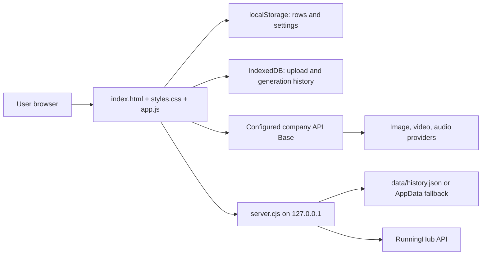
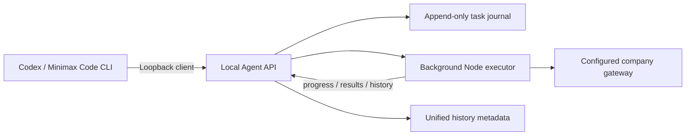

# Architecture

## Overview

APIplusWebtools is a local-first, dependency-free web application and CLI. The browser owns its interface, manual task queues, and local state. The Node service supplies static files, shared history, selected local proxies, and background Agent execution through shared model contracts.



## Runtime Boundaries

### Browser application

`app.js` is the application runtime. It contains:

- global configuration and storage keys;
- model catalogs and payload builders;
- row normalization and persistence;
- page renderers and event handlers;
- upload, clipboard, drag-and-drop, and history utilities;
- one queue per task family;
- asynchronous submission, polling, cancellation, and refresh recovery;
- full-screen image/video previews and result reuse.

`model-contracts.js` contains provider rules that are sufficiently isolated to run in Node tests and the browser. Move pure validation or payload mapping there when practical.

### Local Node service

`server.cjs` has four responsibilities:

1. Serve repository files from the local directory.
2. Read and atomically write the structured history backup through `/api/local/history`.
3. Proxy RunningHub upload, submit, and query operations through `/api/runninghub/*`.
4. Execute supported Agent tasks through `agent-headless.cjs`, persist upload/task/history events, and resume polling without a browser. `workbench-model-catalog.cjs` exposes shared model choices and payload rules.

It is not a general credential vault, database server, or media archive. It binds to `127.0.0.1` unless the operator explicitly changes `HOST`.

### External APIs

Most model calls go from the browser to the API Base selected in the left sidebar. Each model configuration supplies a create endpoint, optional query endpoint, accepted options, validation, and a payload builder.

RunningHub is different: assets are downloaded temporarily by the local Node service, uploaded to RunningHub, then removed from the operating-system temporary directory. The configured key is sent from the browser to the local proxy for each operation and is not written by the server.

## State Model

Each task family owns a row array, queue, running counter, normalizer, renderer, persistence function, and result appender. Current families include image generation, image-to-video, motion imitation, multimodal video, Vidu reference video, and avatar generation.

A row follows this lifecycle:

```text
pending -> queued -> running -> partial -> done
                         |          |
                         +-------> failed
                         +-------> canceled

done/failed/canceled -> dirty when inputs change
```

`dirty` means the displayed result belongs to the previous input snapshot. Submitting the row clears old task IDs and begins a new run.

## Queue And Recovery

- The global concurrency setting controls how many jobs each queue may run.
- A row may expand into multiple jobs according to its generation count.
- Results are appended as individual jobs finish.
- Async create responses are normalized into a task ID and optional task path.
- Task metadata is persisted before the first query.
- Polling returns when the query response contains result data; an empty result means the remote task is still running.
- A task is considered failed after 30 minutes.
- After refresh, persisted active rows are inspected. Jobs with remote task IDs enter a recovery queue and continue querying; they are not created again.

## History And Media

History records store metadata and remote URLs, not image/video/audio binary files. Upload history and generation history are retained separately, categorized by media type, and capped at 1000 records per type. The history page displays 50 groups per page and merges generation records that have identical inputs.

The same history data is mirrored in IndexedDB and the disk backup. Merge logic prefers the newer record and prevents an empty source from erasing non-empty history.

## Packaging Boundary

`scripts/build-portable.ps1` copies only an explicit allowlist. It then:

- leaves API Base empty and preserves neutral node templates, never private gateway addresses or credentials;
- creates an empty `data` directory; `runtime` is empty unless an explicit Node executable and license are supplied;
- excludes Git metadata, browser data, history files, logs, generated archives, and planning notes;
- includes launchers, source, tests, engineering docs, and this Agent guide.

`portable-package.test.cjs` is the executable contract for this boundary.

## Local Agent Execution Plane

`agent-service.cjs` exposes a loopback-only append API. The bundled CLI is admitted locally without manual token configuration; existing bearer-token clients remain compatible. It persists task and history events before acknowledging writes. Agents use the workbench rather than calling providers directly.



The background executor validates tasks against the shared model catalog, uploads staged assets, submits jobs, and persists upstream IDs before polling. Browser and Agent records share the same history view but retain `origin` and `executedBy` metadata. The browser worker remains a compatibility path; supported headless jobs do not depend on it.

Task journals distinguish compatibility `waiting_for_worker`, active execution, resumable `polling`, and non-retriable `submission-unknown`. Restart with upstream IDs resumes polling; uncertain submission is not automatically replayed. CLI `recreate` is a deliberate new draw with a fresh request ID, not recovery of a lost poll.

The Agent store contains structured metadata and remote URLs, not full generated media. Upload history includes original filename, source path, SHA-256, media metadata, and Agent origin. Task history includes complete original input, prompt/options, upstream IDs, progress, errors, and results. Staged input files are temporary and removed after consumption. Agent routes have no delete/history-overwrite operation; destructive actions remain in the browser control plane.

Remote access is represented by `API_BATCH_REMOTE_ACCESS=false` but is not implemented or enabled in this release.
