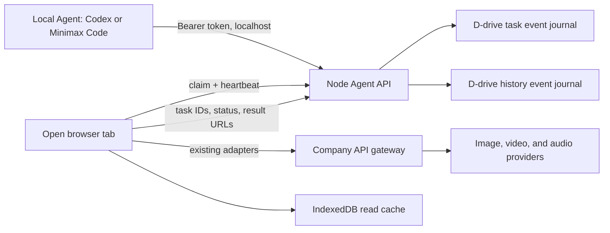

# Local Agent API And Browser Worker Design

## Goal

Expose APIplusWebtools as a local Agent-callable service without duplicating the
existing provider adapters in Node.js.

Codex, Minimax Code, and future local Agents must be able to:

- discover the task types, models, versions, and parameters currently available
  in the web application;
- stage local reference media and submit one task or a batch of tasks;
- observe queue, submission, polling, partial-result, completion, failure, and
  cancellation states;
- receive remote result URLs and task IDs;
- create the same upload-history and generation-history records as manual web
  operations; and
- identify every record by its browser or Agent origin.

The first version is local-only. A browser tab on the gateway computer must
remain open as the execution worker. Private remote access is an explicitly
disabled extension point.

## Non-Goals

- Do not permanently store generated image, video, or audio binaries.
- Do not move every provider adapter from `app.js` into `server.cjs`.
- Do not expose the service on the LAN or public internet by default.
- Do not give Agents a history delete, clear, or arbitrary update operation.
- Do not make the company gateway directly reachable from a remote client.
- Do not replace the existing manual queues or their provider-specific rules.

## Considered Approaches

### A. Local task ledger plus browser worker

The Node service accepts Agent tasks and persists their state. One open browser
tab claims tasks and executes them through the existing row, upload, queue,
provider, polling, and cancellation code.

Advantages:

- one implementation of each model contract;
- identical behavior for manual and Agent-created rows;
- lowest regression risk for the existing provider integrations; and
- supports provider-specific validation and optional cancellation immediately.

Costs:

- at least one browser tab must remain open;
- the worker needs leases, heartbeats, and refresh recovery; and
- a submit response lost before its task ID is persisted needs a conservative
  recovery state.

### B. Native Node execution worker

Move all upload and provider adapters to Node and let the server execute tasks
without a browser.

This would run while the browser is closed, but it duplicates or relocates a
large amount of mature browser behavior and makes future model additions more
expensive. It is not selected for the first version.

### C. Headless browser owned by the server

Start Chromium under PM2 and automate the existing page as a hidden worker.

This removes the visible-tab requirement but introduces browser lifecycle,
profile, automation, update, and debugging complexity. It remains a possible
later deployment mode after the worker protocol is stable.

## Decision

Use approach A for the first version.

The user-facing browser remains the source of provider behavior. The Node
service becomes the authority for Agent task state and shared history metadata.
The protocol must be independent of the visible page so a future headless worker
can use the same claim, heartbeat, report, and recovery endpoints.

## Runtime Architecture



Only the gateway computer performs provider requests. Loading the page on a
different computer does not make that computer a valid execution worker unless
it can reach the company gateway itself.

## Local Binding And Security

The default listener remains:

```text
host: 127.0.0.1
port: 4198
remoteAccess.enabled: false
```

The server must not silently fall back to `0.0.0.0`.

Agent endpoints require:

```http
Authorization: Bearer <local-agent-token>
Content-Type: application/json
```

The token is loaded from `API_BATCH_AGENT_TOKEN` when provided. Otherwise the
server generates a cryptographically random token under the configured data
directory. The same-origin web settings panel can reveal, copy, and rotate it
after an explicit user action.

Worker and manual-control routes use a separate same-origin control session.
The server validates `Host` and `Origin`, issues a `SameSite=Strict` local
session cookie, and denies untrusted CORS preflights. Possessing an Agent token
must never grant manual history deletion.

Future private access may add a trusted Tailscale proxy and identity mapping,
but enabling it requires explicit configuration. No public tunnel behavior is
part of this design.

## Data Directory

The authoritative metadata directory is resolved in this order:

1. `API_BATCH_DATA_DIR` when configured.
2. The launcher-configured external data directory.
3. `<project>/data` as the portable fallback.

For the current workstation, the launcher will use:

```text
D:\Codex test\APItools\APIplusWebtools-data
```

Keeping data outside the Git working tree prevents source updates, checkout,
packaging, and rollback from replacing user history.

Suggested layout:

```text
APIplusWebtools-data/
  config/
    agent-auth.json
  history/
    events.ndjson
    snapshot.json
  tasks/
    events.ndjson
    snapshot.json
  staging/
```

Generated media remains on provider URLs. The local files contain task and
history metadata only.

## Append-Only Persistence

The Node process serializes all metadata writes through one in-process write
queue. The canonical store is an append-only NDJSON event journal. Snapshots are
derived indexes used for fast startup and are written with temporary-file plus
rename atomic replacement.

History creation rules:

- every result receives a stable `recordId`;
- the first `record-created` event for an ID wins;
- retrying the same event is an idempotent no-op;
- there is no Agent endpoint that replaces a record;
- manual edits such as favorite state are separate events;
- manual deletion writes a tombstone event; and
- only the same-origin manual UI may create a tombstone.

The existing per-media-type retention limit of 1000 displayed records remains.
Compaction may remove events that are no longer represented by the retained
projection, but it must never let one browser or Agent overwrite another
client's retained records.

Task state is also event-based. Status transitions append events rather than
accepting a client-provided full task snapshot.

## Existing History Migration

On first startup with the new store:

1. Read the existing disk `history.json` and fallback AppData file.
2. Accept upload and generation records from browser IndexedDB through a
   one-time merge endpoint.
3. Assign stable IDs to legacy records that lack one.
4. Deduplicate by record ID, then by a compatibility fingerprint.
5. Refuse empty migration input as an authoritative replacement.
6. Write a migration marker only after the append journal and snapshot succeed.

After migration, IndexedDB is a browser-side read cache. It is not the authority
and does not upload full replacement snapshots.

## Origin Metadata

The new field is named `origin`; it must not reuse the existing asset `source`
field, which describes acquisition such as URL, clipboard, or copy.

Example Agent origin:

```json
{
  "type": "agent",
  "client": "codex",
  "id": "codex-local",
  "label": "Codex local"
}
```

Example browser origin:

```json
{
  "type": "browser",
  "client": "web",
  "id": "browser-6f90c1",
  "label": "Main Edge"
}
```

Agent-executed records also retain execution attribution:

```json
{
  "origin": { "type": "agent", "client": "codex", "id": "codex-local", "label": "Codex local" },
  "executedBy": { "type": "browser", "id": "browser-6f90c1", "label": "Main Edge" }
}
```

The history UI adds a Source filter covering origin type, client, and label.
Legacy records are shown as `Legacy browser` rather than being hidden.

## Public Agent API

All public Agent routes live under `/api/agent/v1`.

### Capabilities

```http
GET /api/agent/v1/capabilities
```

Returns:

- worker online/offline state;
- supported task families;
- model and version choices;
- parameter schemas and defaults;
- media-slot constraints;
- cancellation capability; and
- the contract version.

The browser worker publishes a capability manifest built from the live model
catalog. The server persists the latest manifest but marks it offline when no
worker heartbeat is active. This avoids maintaining a second model catalog in
Node.

### Stage an asset

```http
POST /api/agent/v1/assets
Content-Type: multipart/form-data
```

The Agent uploads a local file and receives an opaque `assetId`. A task may also
reference an already accessible URL without staging.

Staged files are temporary. The browser downloads the staged content through an
authenticated local route, passes the Blob to the existing upload path, and
reports the resulting remote asset URL. The service deletes the staged file
after successful transfer. Unclaimed or failed staging files expire after a
bounded TTL.

### Submit tasks

```http
POST /api/agent/v1/tasks
```

Single task envelope:

```json
{
  "idempotencyKey": "agent-owned-stable-key",
  "origin": {
    "client": "codex",
    "id": "codex-local",
    "label": "Codex local"
  },
  "taskType": "image-video",
  "model": "Kling",
  "version": "kling-v3",
  "prompt": "...",
  "assets": {
    "firstFrame": { "assetId": "asset-..." },
    "lastFrame": null
  },
  "options": {
    "ratio": "9:16",
    "quality": "pro",
    "duration": 5
  },
  "count": 1
}
```

A batch request wraps multiple envelopes in `tasks`. Single and batch submission
use the same validation and idempotency semantics.

The server performs structural validation. The browser worker performs the
existing provider-specific validation before any upstream submission and
returns actionable validation errors to the Agent task.

### Observe and cancel

```http
GET  /api/agent/v1/tasks/:taskId
GET  /api/agent/v1/tasks/:taskId/events
POST /api/agent/v1/tasks/:taskId/cancel
```

The status response includes row state, per-job state, upstream task IDs,
partial results, errors, timestamps, and history record IDs.

Canceling a pending task removes it from the local queue. Canceling a submitted
task uses the existing optional provider cancellation capability when present;
otherwise it stops local tracking and reports that remote cancellation was not
supported.

### Read results

```http
GET /api/agent/v1/history?taskId=<local-task-id>
```

This endpoint is read-only and returns metadata plus remote result URLs. It does
not proxy or archive full media binaries.

## Browser Worker Protocol

An open tab registers a stable browser instance ID and a user-editable label.
The worker sends a heartbeat every 10 seconds and receives a short task lease.
Only one worker may own a task lease at a time.

Worker lifecycle:

```text
pending -> claimed -> validating -> uploading -> queued
        -> submitting -> submitted -> polling -> partial -> completed
                                      |             |
                                      +-----------> failed
                                      +-----------> canceled
```

The worker maps `taskType` to the existing row constructor and queue:

- image generation;
- image-to-video;
- motion imitation;
- multimodal video;
- Vidu reference video;
- avatar generation; and
- additional task families as they expose a worker adapter.

The created row is saved in its normal task-family list, carries `agentTaskId`
and `origin`, and is visible in the corresponding web page without forcing page
navigation.

## Submission Idempotency And Refresh Recovery

The local task ID and Agent `idempotencyKey` are persisted before a worker may
claim a task.

For every generated job:

1. Append `submitting` before the create request.
2. Append the upstream task ID immediately after the response is parsed.
3. Begin polling only after that event is durable.
4. Append each result as soon as it arrives.
5. Mark the row complete using the final job completion time.

After a page refresh:

- a job with an upstream task ID resumes polling and is never submitted again;
- a job that never reached `submitting` returns to the pending queue;
- a job left at `submitting` without an upstream ID enters
  `submission-unknown` instead of being submitted again automatically; and
- the UI offers an explicit manual retry for `submission-unknown` because the
  provider may already have accepted the original request.

This conservative state prevents accidental duplicate billing during the small
failure window between upstream acceptance and local task-ID persistence.

Expired worker leases do not erase task state. Another tab may claim a task only
after the lease expires and must follow the same recovery rules.

## History Integration

When a worker uploads a reference asset, it appends an upload-history record
with the Agent origin and browser executor. When a result arrives, it appends a
normal generation-history record containing:

- prompt;
- task family;
- model and version;
- options and generation count;
- input asset metadata and remote URLs;
- upstream and local task IDs;
- result URL and media type;
- source origin and executor; and
- creation and completion timestamps.

Manual and Agent records use the same grouping, pagination, preview, favorite,
download, reuse, and source-filter UI. Agent results must not be displayed in a
separate history silo.

## Frontend Controls

Add a compact `Agent API` settings dialog containing:

- local-only status;
- worker online/offline status;
- browser instance label;
- copy/rotate local Agent token;
- pending, active, and recovery task counts; and
- a disabled future private-access section.

The dialog must not expose a control that binds the server publicly.

The history toolbar adds a Source filter. Existing media, model, task type,
size, favorites, and prompt filters continue to compose with it.

## Specialized Skill

Package a portable skill for Codex and Minimax Code with:

- `SKILL.md` decision and safety instructions;
- API schema and task-family examples;
- capability-first model selection;
- local media upload flow;
- idempotent submit and polling flow;
- cancellation behavior;
- error interpretation;
- result and history lookup; and
- environment configuration for base URL, token, and source identity.

The skill must never embed the user's token, company gateway credentials,
browser history, or cached prompts. It calls only the local Agent API and does
not call provider endpoints directly.

## Failure Behavior

- No active browser worker: accept and persist the task as pending, then report
  `waiting_for_worker`.
- Invalid model or options: fail validation before upstream submission.
- Browser refresh: preserve lease-aware state and resume by upstream task ID.
- Server restart: replay task and history journals, then rebuild snapshots.
- Provider timeout: retain the existing 30-minute timeout policy unless the
  provider reports an earlier terminal failure.
- Partial generation: retain each completed result even when sibling jobs fail.
- Staging upload failure: report an asset-specific error and do not submit the
  model task.
- Duplicate Agent request: return the original local task by idempotency key.

## Compatibility And Rollout

1. Add the new server store and migration without removing the old history read
   path.
2. Migrate and verify counts before switching the browser authority.
3. Add Agent task endpoints behind local authentication.
4. Add the browser worker and run manual queue regressions.
5. Add source metadata and filtering while preserving legacy records.
6. Add the portable skill and development documentation.
7. Update packaging so empty runtime directories are shipped but user data and
   secrets are excluded.

The old `/api/local/history` full-snapshot write route remains temporarily for
compatibility but must no longer replace the authoritative store. Empty writes
are ignored. It can be removed after the migration version has been stable.

## Testing

Add focused tests for:

- localhost-only binding and rejected external origins;
- Agent token scope and manual-delete separation;
- append serialization and duplicate record idempotency;
- one-time legacy history migration and empty-write protection;
- source attribution and composed history filters;
- capability manifest registration and offline state;
- task claim exclusivity, lease expiry, and heartbeat renewal;
- single and batch idempotent submission;
- refresh recovery with an upstream task ID;
- `submission-unknown` behavior without an upstream task ID;
- partial results and final completion time;
- optional provider cancellation and local-only fallback;
- staged-file cleanup and absence of permanent media binaries;
- Skill package secret exclusion; and
- portable-package data and secret exclusion.

Run syntax checks, focused Agent API tests, the complete existing test suite,
portable packaging, and a served-page smoke test before completion.
